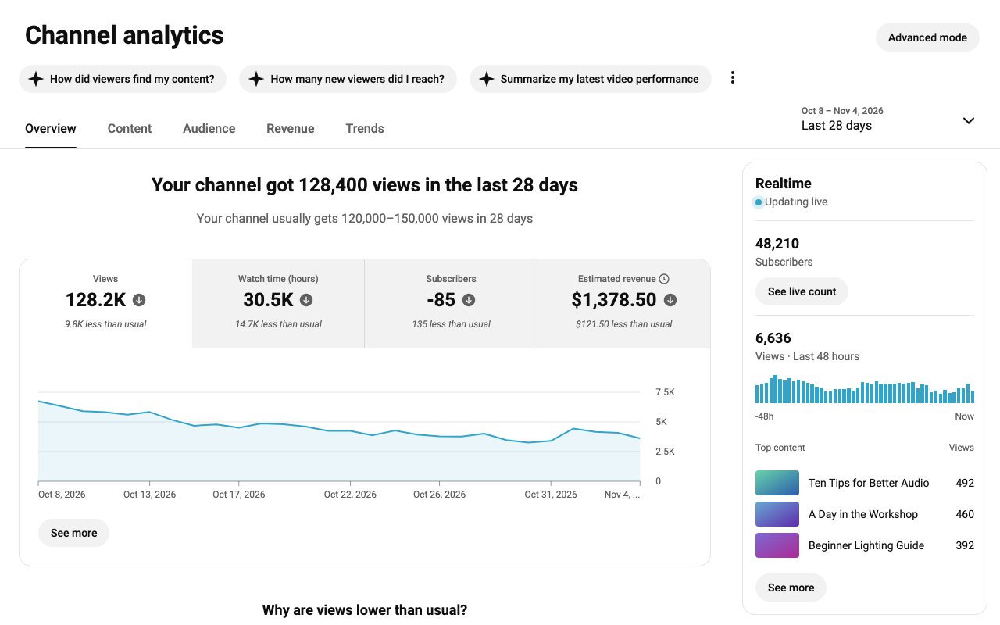

# OG Studio

A Chrome extension that brings back the classic **Channel analytics** and **Channel content** pages in YouTube Studio, for channels that were moved to the new layout.

*Sample data, not a real channel.*

## How it works

YouTube still ships the classic pages. Which layout you get comes down to a few feature flags in Studio's page config, found by comparing the config of a channel on the old layout with one on the new layout.

OG Studio turns those flags off before Studio starts, so Studio's **own** old code runs:

- every Analytics tab, See more report and Advanced mode
- video analytics
- the classic Channel content page and its tabs

Nothing is imitated on this path, so it behaves exactly like the old page.

### Backup page

Flags can change without warning, so there is a fallback. If the flag disappears, or the classic page doesn't render within 30 seconds, OG Studio redraws Channel analytics itself from Studio's data (`extension/src/ui.js`, `tabs.js`). If that data fails too, you get normal Studio.

The Content page has no redraw. If it fails, you get YouTube's current Content page.

### Revenue

Studio's old code can show Revenue on channels that never earned anything. OG Studio hides it unless the channel is monetized now or has earned before, so a channel that lost monetization keeps its history.

## Install

Not on the Chrome Web Store yet.

1. Download `OG-Studio-1.1.0.zip` from [Releases](https://github.com/rishavc300/og-studio/releases) and unzip it.
2. Open `chrome://extensions` and turn on **Developer mode**.
3. Click **Load unpacked** and pick the unzipped folder.
4. Reload any open Studio tabs.

## Project layout

| Path | What it does |
| --- | --- |
| `extension/src/early.js` | Runs first and turns the flags off |
| `extension/src/main.js` | Revenue rule, watchdog, and starting the backup page |
| `extension/src/data.js` | Reads Studio's data for the backup page |
| `extension/src/ui.js`, `tabs.js`, `og.css` | The backup page |
| `tests/early.test.js` | Tests for `early.js`: `node tests/early.test.js` |

## Known limits

- Depends on private YouTube flags, which can change at any time.
- Tested on two channels so far, both in English.
- Advanced mode still lists an Estimated revenue column on channels that never earned.
- The backup page is English only and is close to the old page, not identical.

## Contributing

Issues and pull requests are welcome, especially reports from other channels: monetized or not, other languages, and anything that looks different from the old layout. If the old page stops appearing, the flag names at the top of `early.js` are the first thing to check.

## Privacy

No servers, no tracking, and nothing leaves your browser except Studio's own requests. See [PRIVACY.md](PRIVACY.md).

## Disclaimer

Not affiliated with or endorsed by Google or YouTube. YouTube and YouTube Studio are trademarks of Google LLC.

## License

[MIT](LICENSE)
